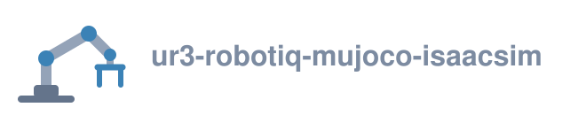
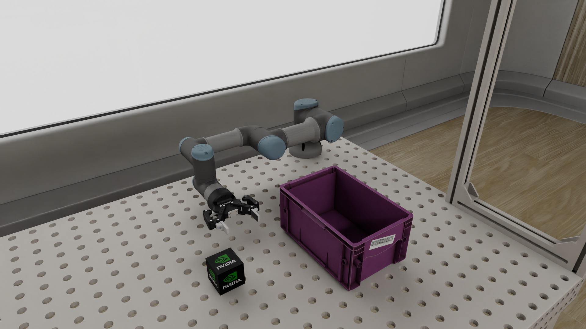
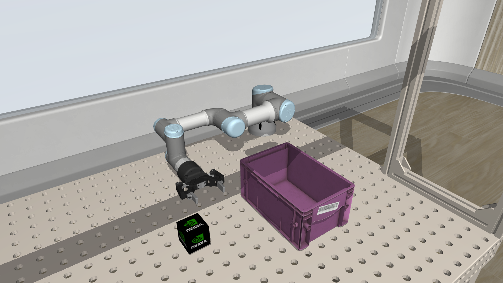

<div align="center">



# UR3 + Robotiq 2F-85 — MuJoCo & Isaac Sim

**The same UR3 + Robotiq 2F-85 tabletop scene, ready to run in NVIDIA Isaac Sim and MuJoCo.**

*Matching assets, poses and world frame in both simulators, with one launcher for each.*

[](https://docs.isaacsim.omniverse.nvidia.com/latest/installation/install_workstation.html)
[](https://github.com/google-deepmind/mujoco)
[](https://www.python.org/)
[](LICENSE)
[](https://github.com/google-deepmind/mujoco_menagerie)

<table>
  <tr>
    <td align="center"><br><b>Isaac Sim</b></td>
    <td align="center"><br><b>MuJoCo</b></td>
  </tr>
</table>

</div>

## Overview

- A UR3 arm with a Robotiq 2F-85 gripper on a welding table, with a KLT bin and a 6.5 cm cube, inside a simple room.
- Two versions of the same scene: USD for Isaac Sim (`assets/usd/scenes/isaacsim_scene_ur3.usd`) and MJCF for MuJoCo (`assets/mjcf/scenes/mujoco_scene_ur3.xml`).
- Shared world frame (Z up, metres): every object, the robot base and the room have the same pose in both scenes, and the robot starts with all joints at 0 and the gripper open.
- The MJCF models of the UR3, the objects and the room were converted from the Isaac Sim USD assets; the MuJoCo gripper is the MuJoCo Menagerie 2F-85, mounted like the Isaac Sim gripper.

## Installation

```bash
git clone https://github.com/fermarc98/ur3-robotiq-mujoco-isaacsim.git
cd ur3-robotiq-mujoco-isaacsim
```

**MuJoCo** (tested with MuJoCo 3.4.0, Python 3.11):

```bash
conda create -n mujoco python=3.11 -y
conda activate mujoco
pip install mujoco==3.4.0 numpy pillow   # viewer and screenshots
```

**Isaac Sim 6.1**: install it following the [official NVIDIA guide](https://docs.isaacsim.omniverse.nvidia.com/latest/installation/install_workstation.html). The scripts expect it in `~/isaacsim` and run with its bundled Python (`~/isaacsim/python.sh`, Python 3.12).

| Script | Interpreter |
|---|---|
| `scripts/launch_isaacsim.py` | `~/isaacsim/python.sh` |
| `scripts/launch_mujoco.py` | `mujoco` conda env (or `~/isaacsim/python.sh`) |
| `scripts/render_screenshots.py` | `--sim isaacsim`: `~/isaacsim/python.sh`; `--sim mujoco`: `mujoco` conda env |

## Quick start

`scripts/launch.sh` picks the right Python for each simulator (override with `ISAACSIM_PYTHON` / `MUJOCO_PYTHON`).

```bash
scripts/launch.sh isaacsim                          # Isaac Sim GUI, scene loaded and playing
scripts/launch.sh isaacsim --paused                 # open the scene without pressing Play
scripts/launch.sh isaacsim --headless --steps 300   # no GUI: run 300 frames, print the joint positions

scripts/launch.sh mujoco                            # MuJoCo viewer (sliders in the Control panel)
scripts/launch.sh mujoco --headless --steps 1500    # no GUI: simulate 1500 steps, print the joint positions
scripts/launch.sh mujoco --model assets/mjcf/robots/ur3_robotiq2f_85/ur3_robotiq2f_85.xml   # any MJCF file
```

MuJoCo actuators: `robot/shoulder_pan`, `robot/shoulder_lift`, `robot/elbow`, `robot/wrist_1`, `robot/wrist_2`, `robot/wrist_3` (joint position targets, rad) and `robot/gripper/fingers_actuator` (0 = open, 255 = closed).

The screenshots above are made with `scripts/render_screenshots.py --sim {isaacsim,mujoco}`.

## Repository structure

```
assets/
├── usd/                              # Isaac Sim
│   ├── scenes/isaacsim_scene_ur3.usd
│   ├── robots/{ur3, 2F-85, ur3_robotiq2f_85}
│   ├── objects/{welding_table, containers/KLT_Bin, manipulation/{Blocks, Food, YCB}}
│   └── environments/Simple_Room
└── mjcf/                             # MuJoCo
    ├── scenes/mujoco_scene_ur3.xml
    ├── robots/{ur3, 2F-85, ur3_robotiq2f_85}
    ├── objects/{welding_table, containers/KLT_Bin, manipulation/Blocks}
    └── environments/Simple_Room
scripts/                              # launch and render
docs/media/                           # logo and screenshots
```

## Known differences between the simulators

- **Gripper**: MuJoCo uses the MuJoCo Menagerie `robotiq_2f85_v4` model with its own tendon actuator (0–255); Isaac Sim uses its own 2F-85 USD with a joint drive. The mount pose is the same, but gripper timing and forces differ.
- **Arm drives**: the MuJoCo arm is tuned like the real UR3 rather than copying the USD drives (kp 6000–12000 N·m/rad, `maxForce` up to 3360 N·m). It has the real torque limits (56 / 56 / 28 / 12 / 12 / 12 N·m). Joint damping keeps speeds near the real limits (about 3 rad/s for the base, shoulder and elbow, 6 rad/s for the wrists). The PD gains reach the target without overshoot, and gravity compensation goes through the actuators. The values and the USD originals are in `assets/mjcf/robots/ur3/ur3.xml`.
- **Room**: the low table prop (`table_low`) is removed from the MuJoCo room only.
- **Not in the USD**: MuJoCo adds a 0.01 kg·m² armature on the wrist joints (stable at the 2 ms timestep), and the UR3 collision shapes come from a CoACD decomposition instead of PhysX `convexDecomposition`.

## Credits and licenses

- **MuJoCo Menagerie** [`robotiq_2f85_v4`](https://github.com/google-deepmind/mujoco_menagerie/tree/main/robotiq_2f85_v4) (Google DeepMind): BSD-2-Clause, © 2013 ROS-Industrial, see `assets/mjcf/robots/2F-85/LICENSE`.
- **NVIDIA Isaac Sim** assets: Robotiq 2F-85 USD and Simple Room, CC BY 4.0 (licenses in `assets/usd/robots/2F-85/` and `assets/usd/environments/Simple_Room/`).
- **UR3** arm by Universal Robots: USD description under BSD-3-Clause, see `assets/usd/robots/ur3/LICENSE`.
- **2F-85** adaptive gripper by Robotiq; **YCB** Object and Model Set (tomato soup can, mustard bottle).
- [MuJoCo](https://github.com/google-deepmind/mujoco) and [CoACD](https://github.com/SarahWeiii/CoACD) are used for simulation and convex decomposition.

The Apache-2.0 [LICENSE](LICENSE) covers the scripts and the files written for this repository. Third-party assets, and files converted from them, keep their original licenses, which stay in their asset folders. UR3, Robotiq and NVIDIA are trademarks of their respective owners.
